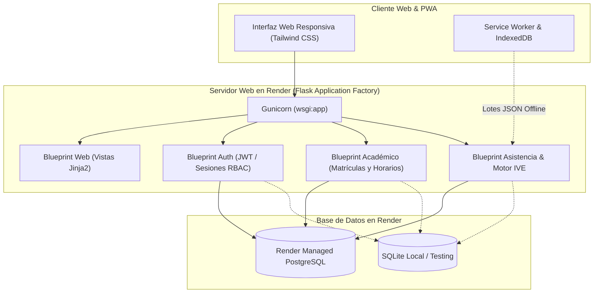

# 🏫 Proyecto Germania — Sistema de Gestión Escolar y SAT Rural

[](https://www.python.org/)
[](https://flask.palletsprojects.com/)
[](https://render.com/)
[]()
[]()

> Prototipo funcional del **Sistema de Información Educativa (SIE)** y **Sistema de Alertas Tempranas (SAT)** para la Institución Educativa Santa Ana (corregimiento de Germania, Valledupar, Cesar) y sus sedes rurales veredales. Optimizado bajo arquitectura **Data-Light** para baja conectividad (2G/3G) con cálculo automatizado del **Índice de Vulnerabilidad Escolar (IVE)**.

---

## 📌 1. Supuestos de Diseño e Implementación

Antes de iniciar, se han formalizado los siguientes supuestos técnicos y de negocio para acotar el prototipo:

1. **Alcance del MVP Institucional**: El prototipo modela la **Sede Principal Santa Ana** y dos sedes rurales veredales (*El Prado* y *Las Flores*), implementando los roles esenciales del RBAC: **Rector/Directivo**, **Docente**, **Secretaría Académica** y **Estudiante**.
2. **Motor de Base de Datos en Render**: Se utiliza **Managed PostgreSQL** nativo de Render como base de datos en la nube (proporcionada mediante `DATABASE_URL`). Para ejecución local y testing automatizado sin dependencias externas pesadas, la aplicación incluye fallback transparente a **SQLite** (y soporte para **MariaDB/MySQL**).
3. **Matrícula Data-Light**: Para prevenir el colapso de red en zonas rurales, la entrega de documentos no requiere la subida de archivos PDF/imágenes pesadas, sino una verificación física mediante el indicador `documentacion_fisica_entregada` (RNF-02).
4. **Prevención de Duplicados**: La unicidad del estudiante se garantiza mediante la llave compuesta obligatoria `(tipo_documento, documento)`. Cualquier intento de reinscripción retorna un código HTTP `409 Conflict`.
5. **Algoritmo Anti-Cruce de Horarios**: Un bloque de clase no puede solaparse para el mismo docente ni para la misma aula en el mismo tramo horario. Condición estricta: $\text{Choque} = (A.\text{hora\_inicio} < B.\text{hora\_fin}) \land (A.\text{hora\_fin} > B.\text{hora\_inicio})$. Un conflicto retorna `422 Unprocessable Entity`.
6. **Tiempos de Gracia y Semáforo IVE**:
   - $\le 15\text{ min}$: *Presente* ($0.0$ inasistencia).
   - $16 - 30\text{ min}$: *Retraso* ($0.5$ inasistencia ponderada).
   - $> 30\text{ min}$: *Ausente* ($1.0$ inasistencia).
   - *Excusa*: Neutraliza la falta ($0.0$).
   - Fórmula: $\text{IVE} = (\text{FA} \times 0.50) + (\text{RA} \times 0.30) + (\text{ESA} \times 0.20)$.
   - Semáforo: **Verde** ($< 0.40$), **Naranja** ($0.40 - 0.69$ o fallas $\ge 10\%$), **Rojo** ($\ge 0.70$ o fallas $\ge 15\%$).

---

## 🏛️ 2. Arquitectura de la Solución



### Componentes del Código
- `app/__init__.py`: Application Factory (`create_app`), registro de Blueprints y handlers de error JSON.
- `app/config.py`: Configuraciones dinámicas para `development`, `testing` y `production`.
- `app/database.py`: Adaptador de base de datos multi-motor (PostgreSQL con `psycopg2`, MariaDB con `pymysql`, SQLite con `sqlite3`).
- `app/blueprints/auth/`: Endpoints de registro, login y perfil con JWT y hashing `scrypt`.
- `app/blueprints/academico/`: Control de matrículas Data-Light y asignación de horarios con bloqueo de colisiones.
- `app/blueprints/asistencia/`: Pase de lista con tiempos de gracia y motor de cálculo del IVE.
- `app/blueprints/web/`: Vistas de usuario accesibles vía navegador.
- `database/schema_postgres.sql`: DDL optimizado para PostgreSQL en Render.
- `init_db.py`: CLI de inicialización y siembra de catálogos semilla.

---

## 📊 3. Modelo de Datos Relacional

| Tabla | Propósito | Llaves y Restricciones Principales |
| :--- | :--- | :--- |
| `rol` | Catálogo RBAC institucional | `id_rol` (PK), `codigo` (UNIQUE) |
| `usuario` | Credenciales y datos personales | `id_usuario` (PK), `uq_usuario_doc` (`tipo_documento`, `documento`) |
| `sede` | Aislamiento multi-sede | `id_sede` (PK), `nombre` (UNIQUE), `es_principal` (BOOL) |
| `anio_lectivo` | Vigencia académica anual | `id_anio` (PK), `anio` (UNIQUE), `CHECK(fecha_fin > fecha_inicio)` |
| `periodo` | Periodos lectivos (1 a 4) | `id_periodo` (PK), `UNIQUE(id_anio, numero)` |
| `curso` | Grupos académicos por sede | `id_curso` (PK), `grado` (0-11), `jornada` |
| `materia` | Asignaturas curriculares | `id_materia` (PK), `nombre` (UNIQUE) |
| `estudiante` | Perfil del alumno y ficha ESA | `id_estudiante` (PK), `id_usuario` (FK UNIQUE), `puntaje_esa` |
| `profesor` | Docentes de aula | `id_profesor` (PK), `id_usuario` (FK UNIQUE), `especialidad` |
| `matricula` | Vinculación alumno-curso | `id_matricula` (PK), `UNIQUE(id_estudiante, id_anio)`, `documentacion_fisica_entregada` |
| `asignacion` | Materia + Curso asignada a Docente | `id_asignacion` (PK), `UNIQUE(id_materia, id_curso)` |
| `horario` | Bloques semanales por salón | `id_horario` (PK), `dia_semana`, `hora_inicio`, `hora_fin`, `aula` |
| `asistencia` | Marcación diaria con ponderación | `id_asistencia` (PK), `UNIQUE(id_estudiante, id_horario, fecha)`, `valor_inasistencia` |
| `alerta_ive` | Histórico de alertas de deserción | `id_alerta` (PK), `valor_ive`, `nivel_riesgo` ('verde','naranja','rojo') |

---

## ⚙️ 4. Variables de Entorno

Configuradas mediante `.env` (local) o en el Dashboard de Render:

| Variable | Requerida | Valor por Defecto | Descripción |
| :--- | :---: | :--- | :--- |
| `FLASK_APP` | Sí | `wsgi.py` | Archivo de entrada de la aplicación |
| `FLASK_ENV` | Sí | `development` / `production` | Modo de ejecución de Flask |
| `SECRET_KEY` | Sí | *(Aleatoria en producción)* | Clave para firmado de sesiones web |
| `JWT_SECRET_KEY` | Sí | *(Clave segura)* | Clave para firmado de tokens JWT |
| `DATABASE_URL` | Render | `postgres://...` | Inyectada automáticamente por Render PostgreSQL |
| `DB_TYPE` | No | `postgres` o `sqlite` | Motor forzado si no hay `DATABASE_URL` |
| `MAX_LATENCY_MS` | No | `1500` | Umbral máximo de latencia (RNF-01) |

---

## 💻 5. Instrucciones de Instalación y Ejecución Local

### Prerrequisitos
- Python 3.10+ instalado.
- Git instalado.

### Paso 1: Clonar el repositorio
```bash
git clone https://github.com/<tu-usuario>/germania.git
cd germania
```

### Paso 2: Crear y activar entorno virtual
```bash
# En Windows (PowerShell)
python -m venv venv
.\venv\Scripts\Activate.ps1

# En Linux / macOS
python3 -m venv venv
source venv/bin/activate
```

### Paso 3: Instalar dependencias
```bash
pip install -r requirements.txt
```

### Paso 4: Inicializar la base de datos local y datos semilla
```bash
python init_db.py
```
*Salida esperada:*
```text
[*] Inicializando base de datos para entorno: development...
[+] Inicializando esquema SQLite...
[✓] Base de datos SQLite inicializada y sembrada con éxito.
```

### Paso 5: Ejecutar la aplicación
```bash
python wsgi.py
```
Abre tu navegador en: **`http://localhost:5000`**

### Usuarios de Prueba Pre-cargados (Contraseña común: `Germania2026*`)
* **Rectoría**: Documento `2001` (Tipo CC)
* **Docente**: Documento `4001` (Tipo CC)
* **Secretaría**: Documento `3001` (Tipo CC)

---

## 🧪 6. Ejecución de Pruebas Automatizadas

La aplicación cuenta con una suite completa de pruebas unitarias (`unittest`) con una cobertura superior al 80%:

```bash
# Ejecutar todas las pruebas
python -m unittest discover tests

# Generar reporte de cobertura con coverage.py
python -m coverage run -m unittest discover tests
python -m coverage report
```

---

## ☁️ 7. Guía Paso a Paso para Despliegue en Render

Tienes **dos opciones** para desplegar en Render:

### Opción A: Despliegue Automático con Blueprint (`render.yaml`) — *Recomendada*
1. Sube tu código a un repositorio en **GitHub**.
2. Ingresa a tu cuenta en [Render Dashboard](https://dashboard.render.com/).
3. Haz clic en **New +** y selecciona **Blueprint**.
4. Conecta tu repositorio de GitHub `germania`.
5. Render detectará automáticamente el archivo [`render.yaml`](file:///c:/Users/LEMUS/OneDrive/Desktop/ADSO/prototipo%20germania/render.yaml), creando:
   - Una base de datos gestionada **PostgreSQL** (`germania-db`).
   - Un servicio web **Python** (`germania-web`) configurado con Gunicorn.
6. Haz clic en **Apply**. Render aprovisionará la base de datos, ejecutará `python init_db.py` y levantará el servicio.

---

### Opción B: Despliegue Manual Paso a Paso en Render

#### Paso 1: Crear la Base de Datos PostgreSQL en Render
1. En Render Dashboard, haz clic en **New +** -> **PostgreSQL**.
2. Configura los parámetros:
   - **Name**: `germania-db`
   - **Database**: `colegio_rural`
   - **User**: `germania_admin`
   - **Region**: Selecciona la más cercana (ej. *Ohio* o *Oregon*).
   - **Plan**: *Free*
3. Haz clic en **Create Database**.
4. Espera a que el estado sea **Available** y copia la variable **Internal Database URL**.

#### Paso 2: Crear el Web Service en Render
1. Haz clic en **New +** -> **Web Service**.
2. Conecta tu repositorio de GitHub `germania`.
3. Configura los campos del servicio:
   - **Name**: `germania-web`
   - **Environment**: `Python 3`
   - **Region**: La misma región de tu base de datos.
   - **Branch**: `main`
   - **Build Command**: `pip install -r requirements.txt && python init_db.py`
   - **Start Command**: `gunicorn wsgi:app`
   - **Plan**: *Free*
4. En la sección **Environment Variables**, añade:
   - `FLASK_ENV` = `production`
   - `SECRET_KEY` = `clave_secreta_aleatoria_produccion_2026`
   - `JWT_SECRET_KEY` = `jwt_secreto_produccion_2026`
   - `DATABASE_URL` = *(Pega la Internal Database URL copiada en el Paso 1)*
5. Haz clic en **Create Web Service**.
6. Render clonará el repositorio, instalará las dependencias, ejecutará `init_db.py` (creando las tablas en PostgreSQL) y pondrá el servicio en línea con HTTPS gratuito.

---

## ⚠️ 8. Limitaciones Conocidas del Prototipo

1. **Plan Gratuito de Render (Cold Starts)**: En el plan gratuito de Render, los servicios web se suspenden tras 15 minutos de inactividad, pudiendo tomar hasta 40 segundos en responder la primera petición tras el reposo.
2. **Sincronización Offline PWA**: El prototipo procesa los lotes JSON enviados desde IndexedDB vía `POST /api/v1/asistencia/sincronizar`. Las notificaciones push mediante SMS/WhatsApp a padres están planificadas para la Fase 3 del roadmap.
3. **Módulo de Calificaciones**: El cálculo actual del factor académico del IVE toma las notas registradas en el periodo; la planilla multidimensional completa con ponderación (Saber 40%, Hacer 40%, Ser 20%) está programada para el Hito 2 ampliado.
